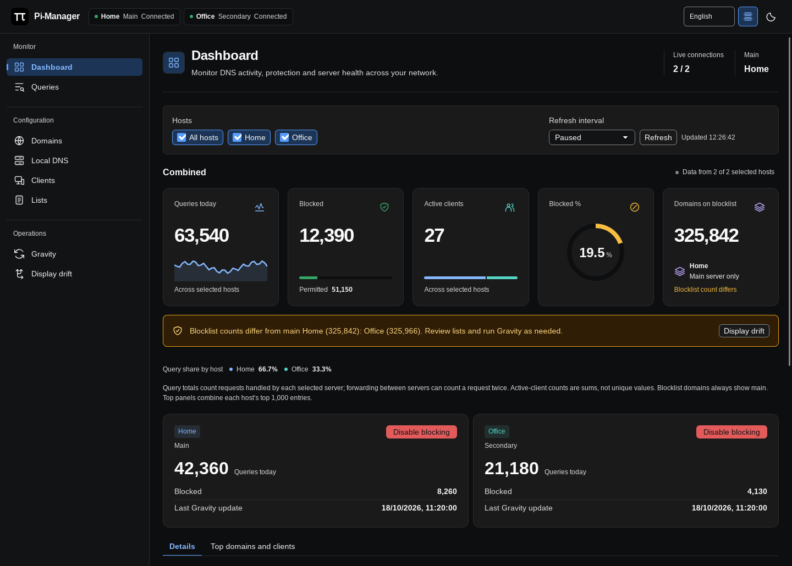
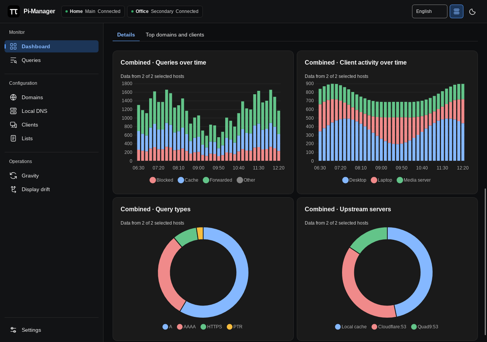
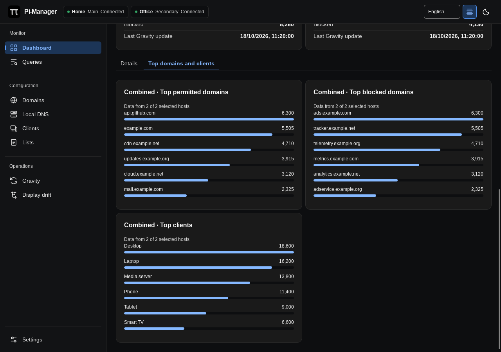

# Dashboard

[Documentation](../README.md#documentation) · [Using Pi-Manager](using-pi-manager.md)

The top row shows server status. Use the host checkboxes on the left to focus on
one server, several servers or the whole fleet. The refresh controls on the
right use the same layout as [Queries](queries.md).

## Read the metrics

Query totals and active-client counts combine the selected hosts. The blocked
percentage reflects the combined query totals. Forwarding between servers can
count a request twice, and active clients are summed rather than deduplicated.

**Domains on blocklist** always shows the main server's total, even when the
host filter changes. A different secondary count raises a warning; open
[Display drift](sync.md) to inspect the actual configuration differences.

Each server card has a **Disable blocking** or **Enable blocking** button in
its top-right corner. It changes blocking on that server.

## Explore the tabs

**Details** is selected initially. It contains query history, client activity,
query types and upstream-server charts for the selected hosts. The coverage
text identifies how many selected hosts supplied data.

See the Details charts

Switch to **Top domains and clients** for the busiest permitted domains,
blocked domains and clients. Top panels combine each host's top 1,000 entries.
The selected tab is remembered across refreshes and navigation. Use the arrow
keys to move between tabs when a tab has keyboard focus.

See Top domains and clients

## Refresh

The default interval is two seconds. Choose realtime (a 500 ms poll), 1, 2, 5,
10, 15 or 30 seconds, one minute, or paused. Each page remembers its own interval.
Intervals run after a request finishes; slower servers can make updates take
longer. **Refresh** requests an update immediately.

Dashboard polling pauses while the window is hidden. Native
[health monitoring](using-pi-manager.md#tray-and-health-monitoring) continues
independently.
