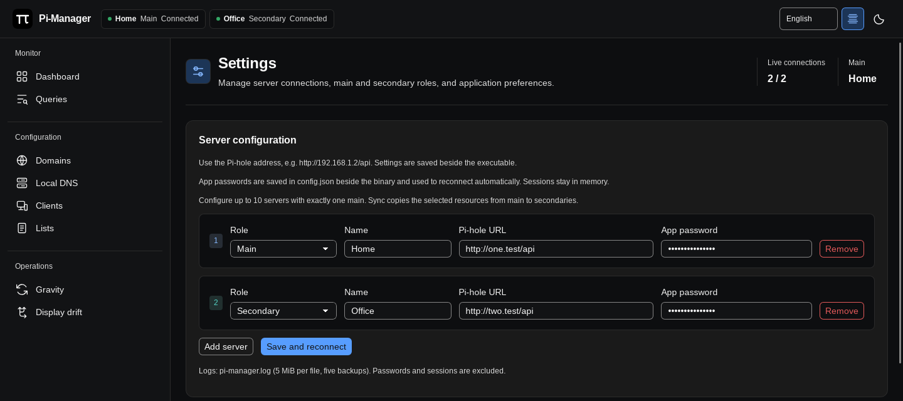

# Getting started

[Documentation](../README.md#documentation)

Find the latest versions under **Releases**, as release artifacts. Choose the
artifact for your operating system and processor, then extract it into a folder
you can write to. Windows, Linux and macOS are supported on amd64 and ARM64.
Release artifacts include documentation, an example configuration, license
notices and checksums.

1. On **Windows**, open the extracted application. It launches without a console
   window. Microsoft Edge WebView2 Runtime is required.
2. On **Linux**, launch the extracted executable. Install GTK 3 and WebKitGTK 4.1
   first. The included desktop installer can add the app and icon to your
   application menu. Keep the extracted folder in its final location before
   installing that launcher.
3. On **macOS**, open the extracted app bundle. WebKit and AppKit are supplied by
   macOS. Release bundles are currently unsigned and are not notarized.

On Debian/Ubuntu systems that provide these package names, install the Linux
runtimes with:

```sh
sudo apt install libgtk-3-0 libwebkit2gtk-4.1-0
```

Linux tray support additionally needs `libayatana-appindicator3-1` (or a
compatible AppIndicator library) and a desktop with a StatusNotifier host. Some
desktops need a tray extension. Without a usable tray, the app keeps normal
window minimization available.

## Connect your servers

1. Open **Settings** and enter a name and URL for each Pi-hole v6 server, such as
   `http://192.168.1.2/api` or `https://pi.hole/api`. The app adds `/api` when omitted.
2. Enter the Pi-hole password or app password accepted by that server's API.
   Passwords are saved in `config.json` so connections can be restored.
3. Mark exactly one server as **Main**. Set the others to **Secondary**. Use
   **Add server** to configure up to 10 servers in total.
4. Save. The app attempts to connect using the saved passwords. Use the server's
   login form in **Settings** if it needs authentication.



Server setup and login controls are available only in **Settings**. Other views
show a **Go to Settings** message for unconfigured or disconnected servers. The
button opens Settings and focuses the relevant server's URL or password field.

Logout is available only in **Settings**. It ends the current connection and
suppresses background reconnection for that session. It does not erase the saved
password; clear the password field and save to remove it.

Next: [Using Pi-Manager](using-pi-manager.md).
