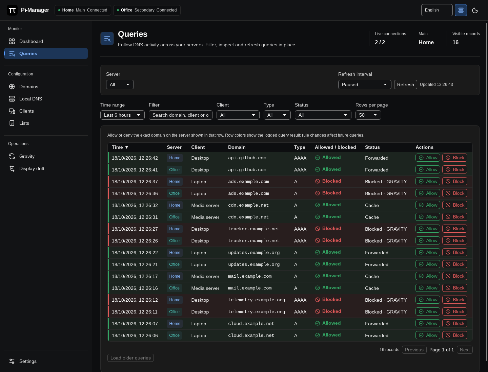

# Queries

[Documentation](../README.md#documentation) · [Using Pi-Manager](using-pi-manager.md)

Inspect queries across your servers. Choose a server on the left of the top
control row; the interval, **Refresh** button and last-update text appear on
the right, matching the [Dashboard](dashboard.md).

## Filter and inspect

Use the time range, text, client, query type and status filters to narrow the
results. Choose the number of rows per page, sort using the column headings,
and use **Load older queries** when more history is available. Filters and
pagination stay in place during polling.

The **Allowed / blocked** column includes a status icon. Green rows indicate
allowed queries; red rows indicate blocked queries. Pending and unknown queries
have separate neutral states. The detailed **Status** column keeps the Pi-hole
result, such as Forwarded, Cache or GRAVITY.

## Allow or block a domain

Use a row's **Allow** or **Block** button to save an exact domain rule on the
server shown in that row. Existing exact entries keep their comments and group
assignments when enabled or moved between lists.

Rules affect future queries. The logged outcome keeps its original color;
filters, polling and the surrounding page stay in place. To include subdomains,
use the wildcard option in [Domains](records.md#domains-and-wildcards).

## Refresh

Queries defaults to a two-second interval. Choose realtime (a 500 ms poll), 1,
2, 5, 10, 15 or 30 seconds, one minute, or paused. The interval is saved separately
from Dashboard. Updates run after the previous request finishes; **Refresh**
requests an update immediately. Polling pauses while the window is hidden.
