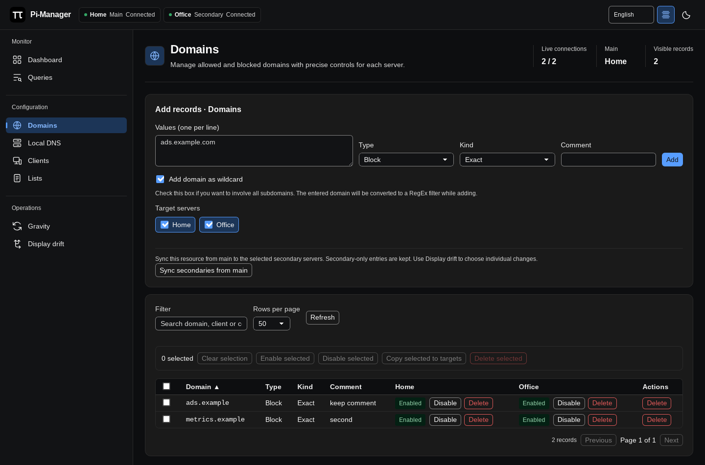
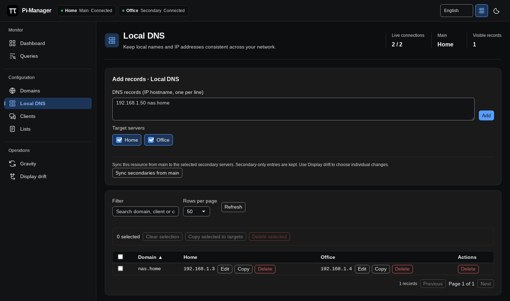

# Managing records

[Documentation](../README.md#documentation) · [Using Pi-Manager](using-pi-manager.md)

Choose target servers before adding or changing records in **Domains**, **Local
DNS**, **Clients** or **Lists**. Use row checkboxes for bulk actions and filters
to narrow the records. Only the affected table content updates after an action,
preserving the surrounding view.

## Domains and wildcards

Add allowed or blocked domains as exact entries or regular expressions. Check
**Add domain as wildcard** to include a domain and all its subdomains. For
example, `example.com` becomes the regex `(\.|^)example\.com$`. A leading `*.`
is optional. This works for allow and block entries and for each domain in a
multiline batch.

Leave the box unchecked for an exact entry, or choose Regular expression to
enter your own regex without conversion.

Use each server's row controls to enable, disable or delete an entry where
supported. Bulk controls apply to selected records and the target servers.

## Local DNS

The Local DNS editor manages host/IP records. Enter one `IP hostname` pair per
line and choose the targets before adding. Existing rows offer edit, copy and
delete controls for each server.

See the Local DNS editor

[Drift comparison and sync](sync.md) also cover CNAME records exposed by the
Pi-hole configuration API.

## Clients and lists

**Clients** manages client identifiers, comments and group assignments, with
device suggestions when available. **Lists** manages list addresses, types,
comments and enabled state. Select multiple rows for the supported bulk actions.

Each record view offers **Sync secondaries from main**. Choose secondary
targets, then confirm the change count to add missing entries and update changed
entries for that resource. Secondary-only entries are kept. Use
[Display drift](sync.md) to select individual changes or remove secondary-only
entries.

## Gravity

**Gravity** starts list database updates on individual servers and shows their
output. **Update gravity on all servers** starts every connected server
together, skipping any already updating. The status line shows ready, running
and logged-out servers; each server keeps its own progress log.
