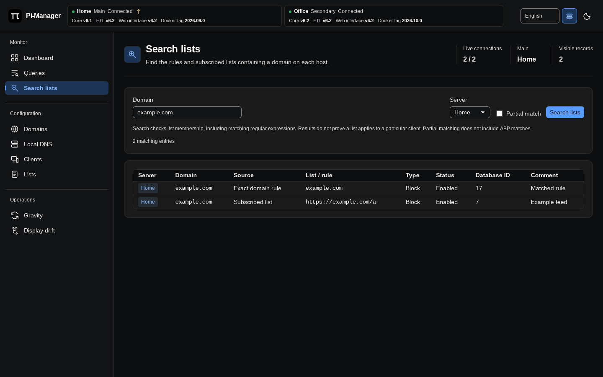

# Search lists

[Documentation](../README.md#documentation) · [Using Pi-Manager](using-pi-manager.md)

Open **Monitor → Search lists**, or choose **Search lists** from a
[paused query's details](queries.md#pause-and-inspect-a-query). The query action
fills in the domain and searches its originating server automatically.

Enter a domain, choose one host or **All hosts**, and click **Search lists**.
The table identifies the host, matched domain, exact or regular-expression rule,
subscribed list address, allow/block type, enabled state, database ID and comment.
Both allow and block list memberships are included.

Check **Partial match** to search for part of a domain. Pi-hole does not include
ABP matches in partial searches. Up to 1,000 matches per type are requested;
if the API reports more matches, narrow the search. Failed or disconnected hosts
are reported separately, and results from responding hosts remain visible.

A match shows membership, not proof that a list caused a particular query's
outcome. Client groups and list enablement can affect whether a rule applies.
Search does not change rules or lists.

This feature uses Pi-hole v6's [`/search/{domain}` API](https://github.com/pi-hole/FTL/blob/master/src/api/docs/content/specs/search.yaml).
