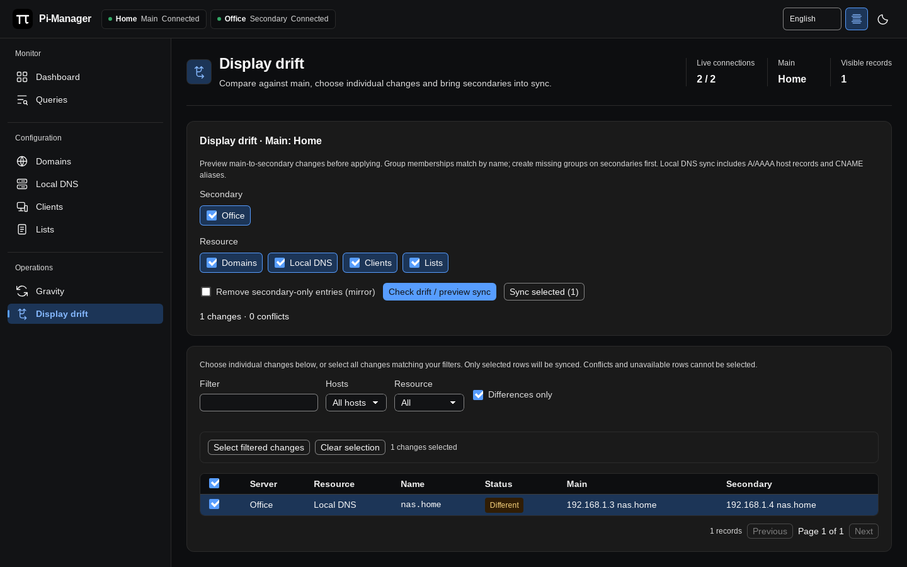

# Drift and sync

[Documentation](../README.md#documentation)

For a quick resource sync, use **Sync secondaries from main** in Domains, Local
DNS, Clients or Lists. It applies missing and changed entries to the secondary
targets you selected after confirmation, preserving secondary-only entries.
Conflicts and unavailable servers are reported. For individual change selection
or mirror deletions, use the drift workflow below.

1. In **Settings**, confirm the correct server is **Main**. Sync always flows
   from that server to the selected secondaries.
2. Open **Display drift**. Choose secondary servers and resource types: domains,
   local DNS, clients and/or lists.
3. Leave mirror mode off to add missing entries and update changed entries.
   Enable it to also offer removal of secondary-only entries.
4. Click **Preview sync**. Inspect the main and secondary values side by side.
   Filter by host, resource, text or differences only.
5. Check individual changes, or use **Select filtered changes**. Review the
   selection count, including selections hidden by the current filter.
6. Click **Apply selected changes** and confirm. Only selected changes apply.
   Even in mirror mode, deletions require selecting the secondary-only rows.

The sample preview selects the different `nas.home` address on Office for sync
from Home. The checkbox and selection count identify exactly what will apply.

A preview does not modify servers. Group assignments are matched by group name
rather than numeric IDs. If configuration changes after a preview, create a new
preview before applying again. Errors are reported per operation. Sync covers
these resource types rather than every Pi-hole setting or query history.
