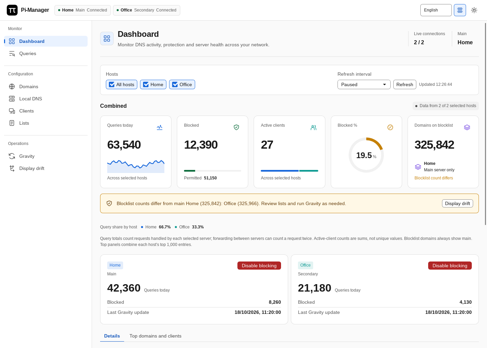
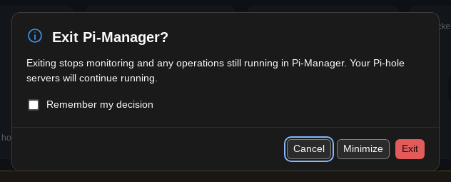

# Using Pi-Manager

[Documentation](../README.md#documentation)

## Navigation and appearance

The Sekura interface uses a navigation rail on wide windows and a menu drawer
on smaller windows. Open the drawer with the menu button; Escape closes it and
returns focus to that button. The content uses the available window width.

Use the header theme button to switch between light and dark mode. Dense mode
is the default. The header density button switches between dense and comfortable
spacing; **Settings → Appearance** also offers compact spacing. Preferences are
saved locally. Appearance shows the running build and interface revision, which
help identify the executable when comparing builds.

Tab moves through controls. Press Enter or Space on a focused table heading to
sort. Confirmation dialogs focus Cancel first and follow the active theme.
Notifications pause while hovered or focused and can be dismissed. Errors stay
visible above the content until dismissed.

## Illustrated guides

Screenshots show the native app with illustrative server data. The examples use
English and dense mode; window decorations and tray availability vary by OS.

- [Dashboard](dashboard.md): combined metrics, host filters, blocking buttons,
  and the Details and Top domains and clients tabs.
- [Queries](queries.md): refresh controls, filters, query outcomes and domain rules.
- [Managing records](records.md): wildcard domains, local DNS, bulk actions and Gravity.
- [Drift and sync](sync.md): preview differences and apply selected changes.
- [Getting started](getting-started.md#connect-your-servers): server setup in Settings.

See the light theme

## Tray and health monitoring

When a usable tray is available, minimizing hides the running window from the
Windows/Linux taskbar or macOS Dock. Use the tray menu to restore the dashboard
or quit. Use the window's normal minimize control, or choose **Minimize** in
the exit confirmation, to minimize to tray. Without a usable tray, Minimize
uses normal window minimization.

Closing the window or choosing Quit opens a confirmation with **Cancel**,
**Minimize** and **Exit**. **Remember my decision** saves the selected behavior in `config.json`.
On macOS, **Command-Q** and **Pi-Manager → Quit Pi-Manager** use the same exit flow.
Remembering Exit skips future confirmations; remembering Cancel keeps the app
open on subsequent close/quit requests. Remembering Minimize minimizes instead
of exiting on subsequent close/quit requests, while monitoring continues.
Change **Settings → Exit behavior** to **Ask before exiting** to restore the confirmation, or choose a different
behavior. Exiting stops Pi-Manager's monitoring and active operations; Pi-hole
servers keep running.

The native monitor keeps sampling while the dashboard is hidden, normally every
five seconds after the previous sample completes. Tray status includes
reachability, DNS blocking, CPU usage, load, RAM usage and temperature when the
server exposes those values. Missing measurements appear as `—`. Settings also
displays host health and tray availability.

For configuration comparison and synchronization, see [Drift and sync](sync.md).
